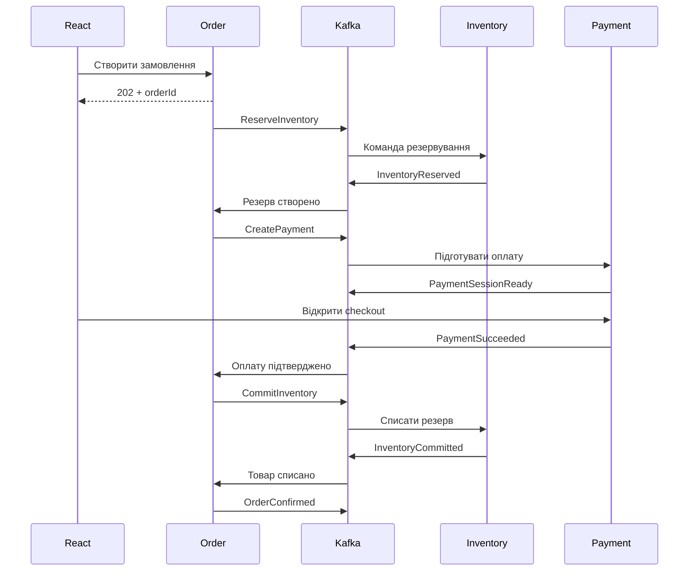

# FlashDrop — покроковий план розробки та навчання

Статус: погоджено. Java 21 LTS використовується для локальної розробки, Maven, CI та Docker images.

## 1. Мета та зафіксовані рішення

FlashDrop — навчальний вебмагазин із розпродажами та обмеженими залишками. Користувач переглядає каталог, додає товари в кошик, оформлює замовлення, оплачує його та бачить результат асинхронної обробки.

Головна навчальна мета — побудувати систему, а потім виміряти її поведінку під навантаженням і під час збоїв.

### Що вивчаємо

- Kafka: партиції, ключі, consumer groups, offsets, повторну доставку, rebalancing.
- Надійність: ідемпотентні producer і consumer, outbox, inbox, retries, DLT.
- Розподілені процеси: Saga, компенсації, таймаути, eventual consistency.
- Інфраструктуру Kafka: KRaft, реплікацію, ISR, вибір лідера, перенесення партицій.
- Масштабування: кілька екземплярів сервісів, кілька producer і consumer.
- Навантаження: throughput, p95/p99, consumer lag, пошук вузьких місць.
- Розробку: Spring Boot, PostgreSQL, Redis, React, Keycloak.
- Експлуатацію: Linux, Docker Compose, HTTPS, моніторинг, резервні копії.
- CI/CD: перевірки pull request, публікацію образів, деплой і rollback.

### Технологічна основа

| Частина | Рішення |
|---|---|
| Backend | Java 21 LTS, Spring Boot, Spring MVC, Spring Security |
| Збірка | Maven Wrapper, багатомодульний проєкт, `java.version=21` |
| Java у CI | JDK 21 |
| Java у Docker | Eclipse Temurin 21 |
| Доступ до даних | Spring Data JPA; SQL для блокувань, outbox та перевірок |
| База даних | PostgreSQL, міграції Flyway |
| Повідомлення | Apache Kafka у KRaft, Spring Kafka |
| Redis | Кеш каталогу та rate limiting |
| Frontend | React, TypeScript, Vite, React Router, TanStack Query |
| Авторизація | Keycloak, OpenID Connect, Authorization Code + PKCE |
| Платежі | Спочатку симулятор, потім LiqPay sandbox |
| Спостереження | Actuator, Micrometer, Prometheus, Grafana, структуровані логи |
| Тести | JUnit, Testcontainers, Awaitility, Vitest, Playwright |
| Навантаження | k6 для HTTP та Java producer для Kafka |
| CI/CD | GitHub Actions, GHCR |
| Розгортання | Linux VPS, Docker Compose, Caddy |

Spring Boot обирається зі стабільної лінійки, сумісної з Java 21. Точні версії залежностей та Docker images фіксуються на етапі початкового налаштування; залежності Spring беруться через Boot BOM. [Вимоги Spring Boot](https://docs.spring.io/spring-boot/system-requirements.html).

### Межі проєкту

У межах цього плану:

- фізичні товари з кількісними залишками;
- кошик із кількома різними товарами;
- одна валюта — UAH;
- користувач і адміністратор;
- повідомлення всередині застосунку;
- симулятор оплати та зовнішній sandbox;
- один VPS для демо;
- локальний кластер Kafka для експериментів.

За межами основного маршруту: Kubernetes, Kafka Streams, Debezium, реальні платежі, доставка, податки, промокоди, маркетплейс із продавцями та повернення підтверджених покупок користувачем.

### Бізнес-правила, які система повинна зберігати

1. Доступний залишок ніколи не стає від’ємним.
2. Товари одного замовлення резервуються всі разом або не резервуються взагалі.
3. Повторний HTTP-запит не створює повторного замовлення.
4. Повторна команда не створює другого резерву, платежу або списання товару.
5. Замовлення підтверджується після успішної оплати й остаточного списання резерву.
6. Невдала оплата або закінчення часу очікування запускає компенсацію.
7. Невідомий результат платежу потребує звіряння з провайдером.
8. Після відновлення залежностей замовлення завершується або потрапляє в явно позначений стан, що потребує втручання.

## 2. Архітектура та основні контракти

### Сервіси

| Компонент | Відповідальність | Власні дані |
|---|---|---|
| Inventory Service | Каталог, ціни, залишки, резерви | Товари, складські залишки, резерви |
| Order Service | Замовлення та оркестрація Saga | Замовлення, позиції, стан Saga, HTTP idempotency |
| Payment Service | Симулятор, checkout, callbacks, звіряння та компенсація платежів | Платежі, операції, callbacks |
| Notification Service | Повідомлення користувачеві | Журнал повідомлень |
| Analytics Service | Проєкції продажів і статистика | Таблиці для читання та звітів |
| Load Generator | Відтворюване навантаження | Конфігурація прогонів і звіти |
| Frontend | Каталог, кошик, замовлення, checkout, адміністрування | Кошик у браузері |
| Keycloak | Облікові записи, вхід, ролі | Окрема база Keycloak |

На початку достатньо одного PostgreSQL instance з окремою базою та користувачем для кожного сервісу. Сервіси не читають чужі таблиці та не виконують спільні SQL joins.

Спільний модуль контрактів містить схеми повідомлень і приклади. JPA entities, repositories та бізнес-логіка між сервісами не розділяються.

### Основний потік замовлення

При відмові або таймауті Order Service надсилає команди звільнення резерву та завершення платіжної операції. Якщо платіж уже успішний, запускається повернення.

### Дані та конкурентні операції

- Ідентифікатори — UUID; час зберігається в UTC.
- Грошові значення — цілі копійки та код валюти.
- Замовлення зберігає snapshot назви, кількості та ціни кожної позиції.
- Ціна визначається сервером; Inventory перевіряє її актуальність при резервуванні.
- Залишок містить `onHand` і `reserved`; доступна кількість — їх різниця.
- Остаточне списання зменшує одночасно `onHand` і `reserved`.
- Звільнення резерву зменшує лише `reserved`.
- Для багатотоварного резерву рядки блокуються в однаковому порядку за `productId`.
- Стан замовлення та Saga захищається версією або блокуванням рядка.
- Бізнес-операції мають унікальні обмеження: один резерв на замовлення, одна операція відповідного типу на платіж.
- Таймери та строки зберігаються в PostgreSQL. Redis TTL не керує життєвим циклом замовлення.

Основні стани замовлення:

`PENDING_RESERVATION → AWAITING_PAYMENT → FINALIZING → CONFIRMED`.

Альтернативні переходи:

- відмова резервування → `REJECTED`;
- відмова оплати або таймаут → `COMPENSATING → CANCELLED`;
- нерозв’язана помилка → `MANUAL_REVIEW`.

Строк очікування оплати — 15 хвилин. Після успішної оплати замовлення переходить у `FINALIZING`; звичайний таймер очікування оплати більше його не скасовує.

### HTTP API

Публічні endpoint-и мають префікс `/api/v1`.

| Endpoint | Поведінка |
|---|---|
| `GET /products` | Каталог із пагінацією |
| `GET /products/{id}` | Товар, ціна, орієнтовна доступність |
| `POST /orders` | Створення замовлення, `202 Accepted`, `orderId` і `Location` |
| `GET /orders` | Замовлення поточного користувача |
| `GET /orders/{id}` | Поточний стан, позиції, причина відмови, готовність checkout |
| `GET /orders/{id}/checkout` | Дані переходу до симулятора або hosted checkout |
| `GET /notifications` | Повідомлення поточного користувача |
| `POST /admin/products` | Створення товару |
| `PATCH /admin/products/{id}` | Зміна назви, ціни й активності |
| `POST /admin/products/{id}/stock-adjustments` | Додавання запасу |
| `GET /admin/orders` | Перегляд замовлень адміністратором |
| `GET /admin/analytics/summary` | Статистика продажів |
| `POST /payments/webhooks/liqpay` | Callback провайдера з перевіркою підпису |

Додаткові правила:

- `POST /orders` вимагає `Idempotency-Key`.
- Повтор із тим самим ключем і вмістом повертає той самий `orderId`.
- Повтор ключа з іншим вмістом повертає `409 Conflict`.
- Одночасні запити з однаковим ключем обробляються через обмеження PostgreSQL.
- Власник замовлення визначається з перевіреного JWT.
- Помилки повертаються у форматі Problem Details.
- До готовності checkout endpoint повертає `202`; для стану, в якому оплата вже неможлива, — `409`.
- Симуляційні та fault-injection endpoint-и доступні лише в локальному й тестовому профілях.

### Kafka

Основні топіки:

| Топік | Producer | Consumer |
|---|---|---|
| `fd.inventory.commands.v1` | Order | Inventory |
| `fd.inventory.events.v1` | Inventory | Order |
| `fd.payments.commands.v1` | Order | Payment |
| `fd.payments.events.v1` | Payment | Order |
| `fd.orders.events.v1` | Order | Notification, Analytics |

Основні повідомлення:

- Команди: `ReserveInventory`, `CommitInventory`, `ReleaseInventory`, `CreatePayment`, `CancelPayment`, `RefundPayment`.
- Події Inventory: `InventoryReserved`, `InventoryRejected`, `InventoryCommitted`, `InventoryReleased`.
- Події Payment: `PaymentSessionReady`, `PaymentSucceeded`, `PaymentFailed`, `PaymentCancelled`, `PaymentRefunded`.
- Події Order: `OrderConfirmed`, `OrderRejected`, `OrderCancelled`.

Спільна оболонка JSON-повідомлення:

`eventId`, `eventType`, `schemaVersion`, `aggregateType`, `aggregateId`, `aggregateVersion`, `occurredAt`, `correlationId`, `causationId`, `payload`.

Правила:

- Ключ усіх повідомлень процесу оформлення — `orderId`.
- Порядок між різними топіками не вважається гарантованим.
- `eventId` зберігається при повторному надсиланні.
- Для кожного обробника — окрема consumer group.
- Notification та Analytics незалежно читають події замовлень.
- Повідомлення не містять паролів, токенів і платіжних реквізитів.
- JSON-схеми та приклади перевіряються в CI.

### Гарантії доставки

Основний підхід — at-least-once доставка з ідемпотентними бізнес-операціями:

1. Бізнес-зміни та outbox записуються в одній DB-транзакції.
2. Publisher надсилає outbox-подію й очікує підтвердження Kafka.
3. Після підтвердження позначає запис опублікованим.
4. Consumer записує inbox, бізнес-зміни й новий outbox в одній DB-транзакції.
5. Kafka offset підтверджується після успішного DB commit.

Перший publisher має одного активного власника на сервіс через PostgreSQL advisory lock і зберігає послідовність повідомлень одного aggregate. Перезапуск може спричинити повторне надсилання — це очікувана поведінка.

Kafka producer налаштовується з `enable.idempotence=true` та `acks=all`. Це не замінює бізнес-дедуплікацію. Kafka transactions вивчаються окремою лабораторною роботою для Kafka → Kafka. [Spring Kafka: exactly-once semantics](https://docs.spring.io/spring-kafka/reference/4.0/kafka/exactly-once.html).

## 3. Послідовність реалізації

Кожен етап завершується працюючим результатом, перевіркою та коротким записом: що очікували, що отримали, що було незрозумілим.

### Етап 0. Підготувати середовище та репозиторій

**Вивчити:** JDK, Maven Wrapper, Git workflow, Docker networks і volumes.

- [ ] Встановити Java 21 LTS та налаштувати її для проєкту й IDE.
- [ ] Ініціалізувати Git безпосередньо в `flash-drop`; перевірити корінь репозиторію.
- [ ] Додати Maven Wrapper, батьківський Maven-проєкт і `java.version=21`.
- [ ] Створити мінімальні Order та Inventory застосунки.
- [ ] Підготувати React + TypeScript застосунок і зафіксувати Node LTS.
- [ ] Додати README, `.gitignore`, приклад environment variables без секретів.
- [ ] Налаштувати початковий GitHub Actions workflow зі збіркою backend на JDK 21 та frontend.
- [ ] Зафіксувати Eclipse Temurin 21 як основу Java Docker images.

**Готово, коли:** чистий checkout збирається через wrapper, обидва сервіси запускаються, CI зелений.

### Етап 1. Зафіксувати модель і контракти

**Вивчити:** межі сервісів, commands/events, Saga, eventual consistency.

- [ ] Описати сутності, стани й бізнес-інваріанти з цього плану.
- [ ] Зафіксувати таблицю переходів станів замовлення, резерву та платежу.
- [ ] Описати HTTP API через OpenAPI.
- [ ] Додати JSON-схеми повідомлень та приклади успішного й невдалого процесів.
- [ ] Записати рішення про outbox/inbox, власність даних і джерело істини для залишків.

**Готово, коли:** для кожної команди зрозумілі обробник, результат, повторна обробка та можлива компенсація.

### Етап 2. Підняти локальну інфраструктуру

**Вивчити:** KRaft, bootstrap servers, advertised listeners, volumes, readiness.

- [ ] Додати Docker Compose із PostgreSQL, Redis та одним Kafka broker.
- [ ] Створити окремі бази й облікові дані сервісів.
- [ ] Додати Flyway та перші міграції.
- [ ] Налаштувати Kafka connections з контейнерів і з IDE на Windows.
- [ ] Створювати топіки явно; вимкнути їх випадкове автоматичне створення.
- [ ] Додати health checks, постійні volumes та процедуру безпечного перезапуску.

На цьому етапі: один broker, replication factor `1`, `min.insync.replicas=1`. Налаштування внутрішніх Kafka-топіків також відповідають одному broker.

**Готово, коли:** дані переживають перезапуск контейнерів; тестові producer і consumer обмінюються повідомленнями.

### Етап 3. Реалізувати каталог і залишки

**Вивчити:** транзакції PostgreSQL, row locks, constraints, індекси.

- [x] Реалізувати товари, ціни, активність, часові межі розпродажу.
- [x] Додати каталог і адміністративні операції.
- [x] Реалізувати багатотоварне резервування в одній транзакції.
- [x] Додати підтвердження та звільнення резерву.
- [x] Захистити залишки обмеженнями БД й однаковим порядком блокувань.
- [x] Підготувати відтворювані початкові товари та залишки (профіль `local`, сім демонстраційних товарів; повторний запуск зберігає поточні дані).

**Готово, коли:** конкурентні запити не створюють від’ємного залишку; нестача одного товару не залишає часткового резерву.

Логіка резервів доступна всередині Inventory Service; інтеграція через Kafka
належить до етапу 5. Інструкції запуску й тестування наведені в
[README сервісу](backend/inventory-service/README.md).

### Етап 4. Реалізувати замовлення та HTTP-ідемпотентність

**Вивчити:** idempotency keys, snapshot даних, асинхронні HTTP API.

- [ ] Реалізувати створення замовлення та збереження позицій.
- [ ] Отримувати актуальні ціни від Inventory через HTTP з обмеженим таймаутом.
- [ ] Додати `Idempotency-Key`, hash запиту та унікальність ключа в межах користувача.
- [ ] Реалізувати перегляд замовлень і Problem Details.
- [ ] Повертати `202` після надійного збереження замовлення та майбутньої команди.

**Готово, коли:** десять однакових, зокрема одночасних, запитів створюють одне замовлення.

### Етап 5. Побудувати перший наскрізний Kafka-процес

**Вивчити:** KafkaTemplate, KafkaListener, offsets, outbox, inbox.

- [ ] Додати outbox до Order та Inventory.
- [ ] Реалізувати polling publisher із повторним надсиланням непідтверджених подій.
- [ ] Реалізувати inbox із унікальністю `(handler, eventId)`.
- [ ] З’єднати `ReserveInventory → InventoryReserved/InventoryRejected`.
- [ ] Прив’язати offset commit до успішного завершення обробки.
- [ ] Додати керовані точки аварійного завершення для локальних експериментів.

**Готово, коли:** замовлення резервує товар через Kafka; перезапуск publisher або consumer не створює другого резерву.

### Етап 6. Реалізувати Payment Service та повну Saga

**Вивчити:** оркестрація, компенсації, невідомий результат операції.

- [ ] Створити Payment Service та контракт `PaymentProvider`.
- [ ] Реалізувати симулятор: успіх, відмова, затримка, тимчасова помилка, пізній результат.
- [ ] Зберігати платіжні задачі в БД; зовнішні виклики виконувати поза DB-транзакцією consumer.
- [ ] Реалізувати успішний процес до `OrderConfirmed`.
- [ ] Реалізувати компенсацію та scheduler прострочених Saga.
- [ ] Додати звіряння завислих платежів і стан `MANUAL_REVIEW`.

Обов’язкові сценарії:

- успіх → списання резерву → підтвердження;
- відмова → звільнення резерву → скасування;
- таймаут → компенсація;
- пізній успішний платіж після початку компенсації → повернення;
- невідомий результат → перевірка статусу перед повторною дією.

Компенсаційні команди також ідемпотентні. Звільнення до приходу запізнілої команди резервування залишає запис, який не дозволяє створити резерв для вже скасованого процесу.

**Готово, коли:** після кожного сценарію узгоджені замовлення, резерв та платіж.

### Етап 7. Додати Keycloak і контроль доступу

**Вивчити:** OIDC, OAuth2, JWT, PKCE, roles, resource server.

- [ ] Додати Keycloak з окремою PostgreSQL базою.
- [ ] Створити realm `flash-drop`, SPA client та ролі `BUYER` і `ADMIN`.
- [ ] Налаштувати Spring Security resource server у сервісах із публічним API.
- [ ] Перевіряти підпис, issuer, audience та належність ресурсу користувачеві.
- [ ] Підготувати локальних тестових користувачів.
- [ ] Захистити адміністративні endpoint-и; callback провайдера перевіряється його підписом.

SPA використовує Authorization Code + PKCE; access і refresh tokens залишаються в пам’яті браузера. [Keycloak JavaScript adapter](https://www.keycloak.org/securing-apps/javascript-adapter).

**Готово, коли:** покупець бачить власні замовлення, адміністратор керує каталогом, чужі ресурси недоступні.

### Етап 8. Побудувати React-застосунок

**Вивчити:** маршрутизація, server state, авторизація SPA, асинхронний UX.

- [ ] Реалізувати каталог, сторінку товару та кошик із кількома позиціями.
- [ ] Зберігати кошик локально в браузері.
- [ ] Додати вхід, вихід, оформлення та історію замовлень.
- [ ] Генерувати один idempotency key на спробу checkout і повторно використовувати його при мережевих повторах.
- [ ] Оновлювати стан незавершеного замовлення polling-запитами раз на дві секунди; зупиняти їх у кінцевому стані.
- [ ] Додати сторінку симулятора оплати.
- [ ] Реалізувати адміністративні екрани каталогу, залишків і замовлень.

Інтерфейс показує окремі стани: оформлення, очікування оплати, завершення, успіх, відмова та компенсація.

**Готово, коли:** весь шлях покупки проходиться через браузер, зокрема після оновлення сторінки.

### Етап 9. Додати Redis, повідомлення та аналітику

**Вивчити:** cache-aside, rate limiting, незалежні consumer groups, CQRS.

- [ ] Додати кеш каталогу з TTL та інвалідацією після адміністративних змін.
- [ ] Реалізувати Redis rate limiting для створення замовлень.
- [ ] При недоступному Redis читати каталог із PostgreSQL; limiter у демо працює fail-open із метрикою.
- [ ] Реалізувати Notification Service з одним записом повідомлення на бізнес-подію.
- [ ] Реалізувати Analytics Service: підтверджені замовлення, виручка, продажі за товарами.
- [ ] Додати екрани повідомлень і статистики.
- [ ] Перебудувати аналітику окремою consumer group у нові таблиці та порівняти результат.

Повторне читання виконує лише побудову проєкцій. Повнота відновлення перевіряється в межах доступної історії Kafka.

**Готово, коли:** відмова кешу не порушує правильність замовлень, а проєкція відновлюється з подій.

### Етап 10. Реалізувати retries, DLT та відновлення

**Вивчити:** тимчасові й постійні помилки, backoff, poison messages.

- [ ] Відокремити бізнес-відмови від технічних помилок.
- [ ] Для основних обробників застосувати обмежені blocking retries з backoff.
- [ ] Для тривалої недоступності БД призупиняти обробку й відновлювати її після повернення залежності.
- [ ] Невалідні або непридатні повідомлення спрямовувати в DLT відповідного обробника.
- [ ] Підтверджувати offset лише після успішної обробки або підтвердженого запису в DLT.
- [ ] Додати CLI-процедуру перегляду та контрольованого повторного надсилання.
- [ ] Для Notification окремо дослідити retry topics.

Повідомлення в DLT не означає завершення Saga: завислий процес має бути видимий у моніторингу.

Retry topics вивчаються з урахуванням зміни порядку обробки; їх не поєднуємо з Kafka container transactions. [Spring Kafka: non-blocking retries](https://docs.spring.io/spring-kafka/reference/retrytopic.html).

**Готово, коли:** помилкову подію можна знайти, виправити причину збою та повторити обробку без дублювання ефектів.

### Етап 11. Додати спостереження за системою

**Вивчити:** latency, throughput, lag, readiness, кореляція подій.

- [ ] Додати Actuator, Micrometer, Prometheus і Grafana.
- [ ] Збирати Kafka broker та consumer group метрики.
- [ ] Налаштувати JSON-логи з `orderId`, `eventId`, `correlationId` та назвою сервісу.
- [ ] Побудувати dashboards для HTTP, бізнес-процесу, outbox, DLT, Kafka та PostgreSQL.
- [ ] Додати сигнали про тривалий lag, старі outbox-записи, завислі Saga та брак диска.
- [ ] Навчитися знаходити шлях одного замовлення через усі сервіси.

**Готово, коли:** причина навмисно створеного збою визначається за метриками та логами.

### Етап 12. Побудувати Kafka-кластер і дослідити реплікацію

**Вивчити:** KRaft quorum, leader/follower, ISR, replication factor, min ISR.

- [ ] Додати окрему конфігурацію з трьома Kafka nodes у combined broker/controller mode.
- [ ] Використовувати окремі volumes від одноброкерного середовища.
- [ ] Створити топіки з шістьма партиціями, replication factor `3`, `min.insync.replicas=2`.
- [ ] Налаштувати відповідну реплікацію внутрішніх Kafka-топіків.
- [ ] Вимкнути broker із leader-партиціями та виміряти відновлення.
- [ ] Повернути broker і простежити відновлення ISR.
- [ ] Перевірити відсутність втрати підтверджених тестових записів.

Щоб окремо дослідити min ISR без втрати більшості KRaft, створити лабораторний топік із `min.insync.replicas=3` і вимкнути один вузол. Потім повернути стандартне значення `2`.

Три процеси на одному комп’ютері моделюють відмову процесів; відмова цілого хоста потребує окремих машин. [Kafka topic configuration](https://kafka.apache.org/41/configuration/topic-configs/).

**Готово, коли:** є звіт із leader/ISR до збою, під час збою та після відновлення.

### Етап 13. Дослідити масштабування і Kafka transactions

**Вивчити:** partitions vs replicas, rebalancing, producer batching, transaction boundaries.

- [ ] Запустити кілька екземплярів Order, Inventory та Payment.
- [ ] На одному топіку з шістьма партиціями порівняти 1, 3, 6 і 9 consumer instances однієї групи.
- [ ] Запустити три незалежні producer instances з тестовими даними.
- [ ] Перезапускати consumers під час роботи та вимірювати rebalancing.
- [ ] Додати четвертий broker-only node і перенести на нього частину реплік.
- [ ] На окремому perf-топіку порівняти рівномірні ключі та один «гарячий» ключ.
- [ ] Дослідити `linger.ms`, `batch.size` і compression, змінюючи по одному параметру.

Окрема лабораторна робота:

- Kafka consumer → обробка → інший Kafka-топік;
- transactional producer з унікальним transactional ID для екземпляра;
- offset та вихідні повідомлення в одній Kafka-транзакції;
- downstream consumer із `read_committed`;
- аварія до commit і перевірка результату після повторного запуску.

Ця гарантія не поширюється автоматично на PostgreSQL або LiqPay.

**Готово, коли:** результати пояснюють межу масштабування за партиціями та різницю між реплікацією, ідемпотентністю й Kafka transactions.

### Етап 14. Провести відтворювані навантажувальні прогони

**Вивчити:** workload, percentiles, bottlenecks, saturation, recovery time.

- [ ] Підготувати k6-сценарії для каталогу, checkout і flash sale.
- [ ] Підготувати Java Kafka generator із налаштуванням швидкості, кількості producer, розміру повідомлень і розподілу ключів.
- [ ] Для навантаження заздалегідь отримувати тестові JWT; не змішувати перевірку login із throughput замовлень.
- [ ] Запускати raw Kafka тести в окремих perf-топіках.
- [ ] Збільшувати Kafka-навантаження сходинками: 100 → 1 000 → 5 000 подій/с, далі — за ресурсами.
- [ ] Для HTTP окремо знайти максимальне стале навантаження всього бізнес-процесу.
- [ ] Додати прогони із повільним consumer, зупинкою broker і тимчасовою відмовою PostgreSQL.
- [ ] Зберігати seed, конфігурацію, commit SHA, характеристики середовища та результати.

Обов’язковий correctness-прогін: запас 1 000 одиниць одного товару, 10 000 замовлень по одній одиниці, симулятор завжди успішний. Після завершення: 1 000 підтверджених замовлень, решта відхилені через нестачу запасу.

Для кожного прогону вимірювати:

- HTTP RPS і Kafka records/s окремо;
- p95/p99 HTTP та end-to-end latency;
- lag і час обробки накопичених подій;
- outbox backlog;
- помилки, дублікати й порушення інваріантів;
- CPU, RAM, диск і DB connections.

**Готово, коли:** знайдено й підтверджено вимірюваннями щонайменше одне вузьке місце; оптимізація порівняна на однаковому workload.

### Етап 15. Підготувати реліз і вручну розгорнути VPS

**Вивчити:** Linux, SSH, DNS, TLS, container lifecycle, backups.

- [ ] Побудувати Docker images для кожного сервісу та frontend; Java images використовують Eclipse Temurin 21.
- [ ] Налаштувати CI: backend tests на JDK 21, frontend checks, contract checks, browser smoke test.
- [ ] Після merge публікувати images у GHCR з commit SHA та створювати release manifest.
- [ ] Вибрати VPS за актуальними цінами та бюджетом перед орендою.
- [ ] Початковий орієнтир для компактного демо: Linux, 4 vCPU, 8 ГіБ RAM, SSD; перед стабільним запуском перевірити фактичне споживання.
- [ ] Налаштувати SSH-доступ, Caddy, домен, HTTPS та Compose production configuration.
- [ ] Відкрити публічно лише HTTP/HTTPS; SSH обмежити. Бази, Kafka й адміністративні інструменти залишити у внутрішній мережі.
- [ ] Запустити компактний профіль з одним Kafka broker.
- [ ] Налаштувати резервне копіювання PostgreSQL, включно з Keycloak, та перевірити відновлення.

Caddy є спільною точкою входу: frontend, `/auth` для Keycloak та API-маршрути до сервісів. Зовнішній і внутрішній доступ до Keycloak повинні використовувати узгоджений issuer.

На VPS запускаються готові образи, а секрети зберігаються поза Git. Кластерні та важкі навантажувальні експерименти залишаються локальними.

**Готово, коли:** магазин доступний через HTTPS, дані переживають перезапуск сервера, резервну копію відновлено в окрему тестову БД. [Docker Compose у production](https://docs.docker.com/compose/how-tos/production/), [публікація Docker images через GitHub Actions](https://docs.github.com/en/actions/tutorials/publish-packages/publish-docker-images).

### Етап 16. Автоматизувати деплой та rollback

**Вивчити:** immutable releases, deployment secrets, migrations, rollback.

- [ ] Додати CD workflow, який запускається вручну з конкретним release SHA.
- [ ] На сервері завантажувати саме цей release manifest і відповідні образи.
- [ ] Заборонити одночасні деплої.
- [ ] Виконувати перевірку конфігурації та міграції перед оновленням застосунків.
- [ ] Оновлювати застосунки без перестворення контейнерів баз та Kafka.
- [ ] Перевіряти health і виконувати smoke test створення замовлення із симулятором.
- [ ] Зберігати попередній manifest та виконувати rollback застосунків при невдалому smoke test.
- [ ] Відпрацювати навмисно зламаний реліз.

Міграції виконуються за підходом expand/contract, щоб попередня версія застосунку залишалася сумісною з БД. Rollback застосунків не означає автоматичного відкату SQL-міграцій.

**Готово, коли:** одна команда запуску workflow доставляє конкретний реліз, а зламаний реліз можна повернути до попереднього стану.

### Етап 17. Підключити LiqPay sandbox

**Вивчити:** hosted checkout, callbacks, підписи, reconciliation.

- [ ] Отримати sandbox-доступ і тестові ключі LiqPay.
- [ ] Реалізувати LiqPay adapter для вже наявного `PaymentProvider`.
- [ ] Формувати checkout на сервері та відправляти покупця на платіжну сторінку провайдера.
- [ ] Використовувати стабільний provider order ID, пов’язаний із замовленням.
- [ ] Перевіряти callback-підпис за актуальним протоколом LiqPay.
- [ ] Зберігати й дедуплікувати callbacks; перевіряти суму, валюту та відповідність платежу.
- [ ] Визначати результат за перевіреним callback або status API.
- [ ] Реалізувати звіряння невідомих станів і компенсаційне повернення.
- [ ] Перевірити повторні, запізнілі та некоректні callbacks.

Повернення браузера з checkout не підтверджує оплату. Доступ до sandbox є зовнішньою передумовою цього етапу; решта проєкту працює із симулятором.

**Готово, коли:** sandbox-покупка проходить весь процес, а повторний callback не створює повторних змін. [LiqPay: початок роботи та тестовий режим](https://www.prod.liqpay.ua/en/information/instructions/how_to_start).

## 4. Загальна стратегія перевірки

Тести додаються разом із відповідною поведінкою. Кластерні експерименти та великі навантаження запускаються окремо від звичайного CI.

| Рівень | Обов’язкові сценарії |
|---|---|
| Unit | Переходи станів, грошові розрахунки, дедлайни, рішення Saga |
| PostgreSQL integration | Конкурентний резерв, багатотоварний rollback, idempotency keys, унікальні операції |
| Kafka integration | Outbox/inbox, повторна доставка, offset після DB commit, DLT |
| Contract | JSON-схеми, сумісність подій, OpenAPI |
| Browser | Вхід, кошик, успішна покупка, відмова, відновлення після reload |
| Security | Чужі замовлення, admin-доступ, недійсний JWT, некоректний callback |
| Failure | Аварії publisher/consumer, недоступна БД, повільна оплата, пізній успіх |
| Infrastructure | Втрата broker, ISR recovery, rebalancing, перенесення реплік |
| Deployment | Smoke test, невдалий реліз, rollback, відновлення backup |
| Performance | Flash sale, тривалий потік, burst, lag recovery, гарячий ключ |

Ключові точки аварійної перевірки:

1. Після DB commit до публікації outbox.
2. Після Kafka acknowledgment до позначення outbox опублікованим.
3. Після DB commit consumer до offset commit.
4. Після запиту до платіжного провайдера до запису результату.
5. Під час компенсації та при запізнілому результаті.

Для асинхронних інтеграційних тестів використовуються Testcontainers і Awaitility з обмеженим часом очікування. [Spring Boot: Testcontainers](https://docs.spring.io/spring-boot/reference/testing/testcontainers.html).

## 5. Профілі запуску та критерії завершення проєкту

### Профілі

| Профіль | Призначення |
|---|---|
| `dev` | Один broker, інфраструктура в Compose, сервіси можна запускати з IDE |
| `full` | Усі сервіси, React, Keycloak, сповіщення та аналітика |
| `observability` | Додавання Prometheus, Grafana та exporters |
| `kafka-lab` | Три Kafka nodes, окремі дані та налаштування реплікації |
| `perf` | Генератори, симулятор, fault injection, обмежена історія тестових даних |
| `vps` | Готові images, один broker, HTTPS, зовнішні секрети, без тестових endpoint-ів |

Топіки бізнес-подій зберігають історію сім днів, DLT — чотирнадцять. Perf-топіки мають коротшу retention і обмеження розміру. Для replay завжди перевіряється наявність потрібної історії.

Обсяг Docker RAM на поточному комп’ютері — близько 15,4 ГіБ. Для великих прогонів запускається лише потрібний набір компонентів; resource limits і JVM heap задаються явно.

### Проєкт завершено, коли

- [ ] Покупець може пройти весь шлях через браузер.
- [ ] Адміністратор керує товарами, запасом і бачить статистику.
- [ ] Повторні HTTP-запити та Kafka-події не дублюють бізнес-операції.
- [ ] Немає overselling під конкурентним навантаженням.
- [ ] Відмови й таймаути завершуються компенсацією або видимим `MANUAL_REVIEW`.
- [ ] Є результати експериментів із реплікацією, ISR та rebalancing.
- [ ] Перевірене масштабування кількох producer і consumer.
- [ ] Є відтворюваний звіт про продуктивність і знайдені обмеження.
- [ ] Аналітична проєкція перебудовується з доступної історії.
- [ ] CI перевіряє зміни, CD розгортає конкретний реліз.
- [ ] Магазин працює на VPS через HTTPS.
- [ ] Rollback і відновлення резервної копії перевірені практично.
- [ ] LiqPay sandbox інтегрований після отримання тестового доступу.
- [ ] README дозволяє іншому розробнику зібрати, запустити та дослідити систему.
